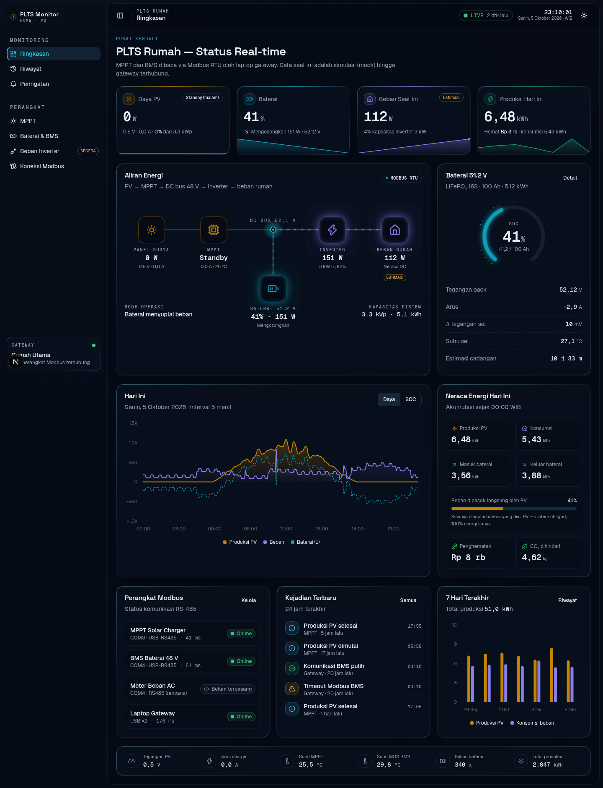
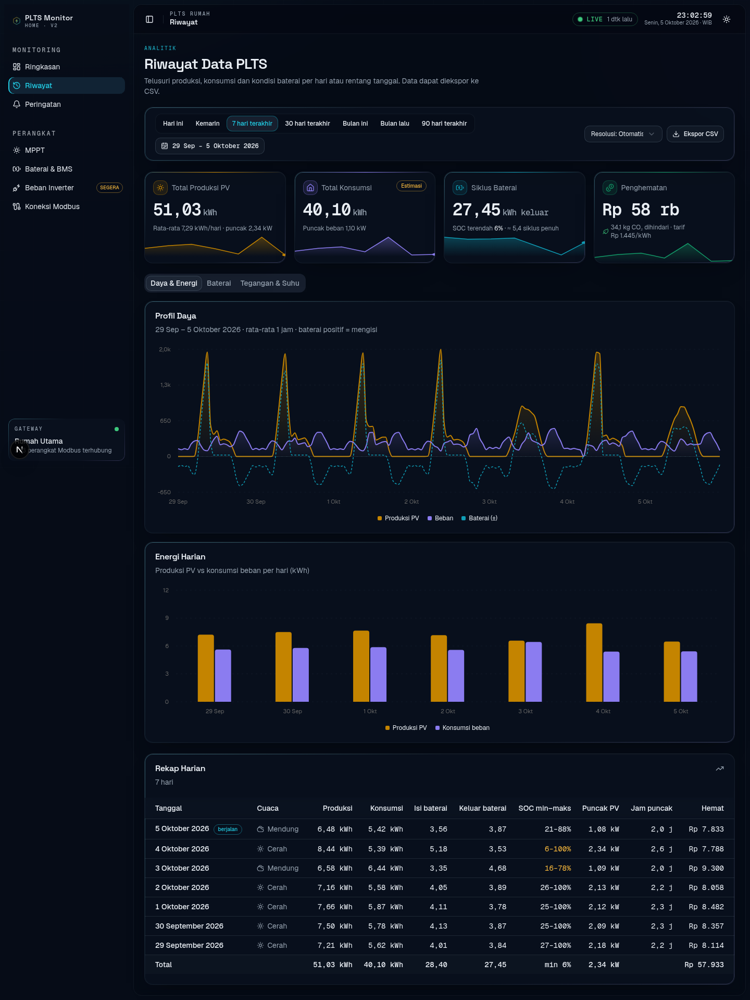
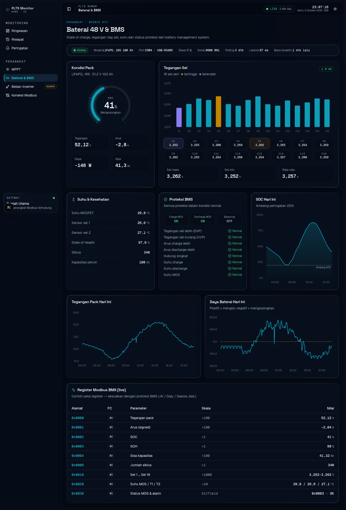
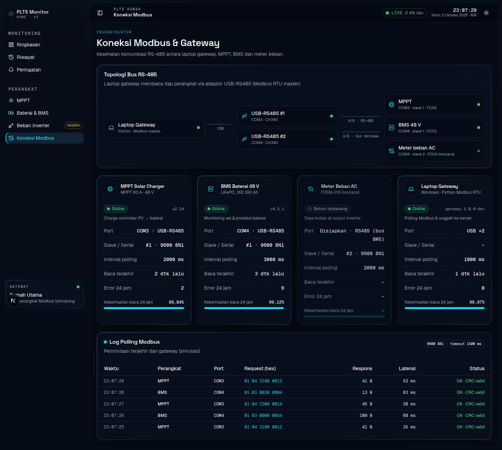
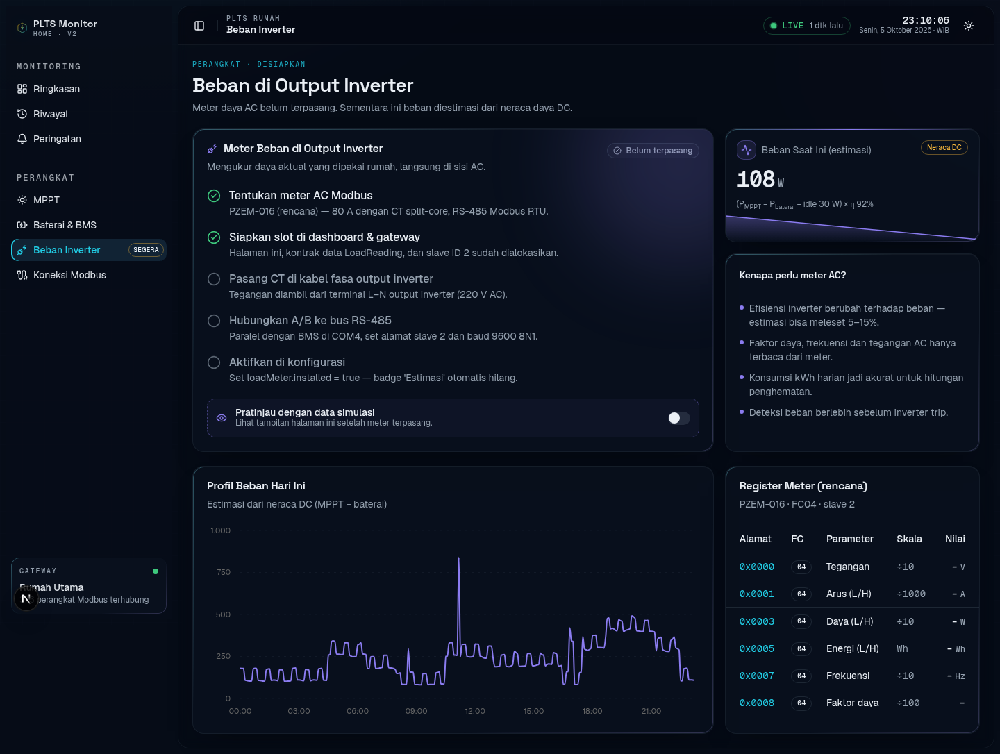

# PLTS Monitor — Home v2

Dashboard untuk memantau PLTS rumah secara online. Tampilannya futuristik, dibangun
dengan **Next.js 16 + Tailwind CSS v4 + shadcn/ui + Recharts**.

Perangkat yang dipakai di v2 (menggantikan setup inverter tunggal di
[monitor-plts-via-modbus](https://github.com/heritechlab/monitor-plts-via-modbus)):

| Perangkat | Koneksi | Status |
|---|---|---|
| MPPT solar charge controller | Modbus RTU via USB-RS485 → laptop (COM3) | Aktif |
| Baterai 48 V LiFePO₄ 16S + BMS | Modbus RTU via USB-RS485 → laptop (COM4) | Aktif |
| Meter beban AC di output inverter (mis. PZEM-016) | Modbus RTU, satu bus dengan BMS (slave 2) | **Disiapkan** |

> Untuk saat ini **seluruh data adalah mock** dari simulator yang deterministik
> (`apps/web/src/lib/plts/mock.ts`). Simulator ini memodelkan cuaca harian, profil
> beban rumah, dan SOC baterai yang berlanjut antarhari, jadi grafik dan riwayatnya
> terlihat realistis.



## Menjalankan

Butuh Node.js 20.9 atau lebih baru.

```bash
npm run setup   # install dependency di apps/web
npm run dev     # http://localhost:3000
```

Perintah lain: `npm run build`, `npm run start`, `npm run lint`, `npm run typecheck`.

## Halaman

| Rute | Isi |
|---|---|
| `/` **Ringkasan** | KPI live (PV, SOC, beban, produksi), diagram aliran energi beranimasi, gauge baterai, grafik hari ini (daya/SOC), neraca energi, status perangkat, kejadian terbaru, 7 hari terakhir |
| `/riwayat` **Riwayat** | Filter: Hari ini, Kemarin, 7/30/90 hari, Bulan ini, Bulan lalu, rentang tanggal kustom (kalender), navigasi per hari, dan resolusi (5 menit, 1 jam, harian). Ada grafik daya, energi harian, SOC, Δ sel, tegangan dan suhu, tabel rekap harian atau per jam, serta **ekspor CSV** |
| `/peringatan` **Peringatan** | Linimasa alarm dan kejadian dengan filter tingkat, sumber, pencarian, dan rentang tanggal |
| `/mppt` **MPPT** | Daya/tegangan/arus PV, tahap pengisian (Bulk/Absorption/Float), spesifikasi, register Modbus live |
| `/baterai` **Baterai & BMS** | SOC, tegangan 16 sel (min/maks), suhu, SOH, siklus, proteksi BMS, register Modbus |
| `/beban` **Beban Inverter** | Checklist pemasangan meter AC, estimasi beban dari neraca DC, pratinjau data meter (simulasi), register rencana |
| `/perangkat` **Koneksi Modbus** | Topologi bus RS-485, kesehatan tiap perangkat (latensi, tingkat keberhasilan baca, error), log polling live |

Tema gelap adalah default. Tema terang tersedia lewat tombol di header.

| | |
|---|---|
|  |  |
|  |  |

## Struktur

```
apps/web/src
├── app/(dashboard)/        # rute halaman (layout: sidebar + header + live provider)
├── components/
│   ├── ui/                 # komponen shadcn/ui
│   ├── layout/             # sidebar, header, tema, LiveProvider (polling 2 dtk)
│   ├── dashboard/          # aliran energi, gauge SOC, stat card, status
│   ├── charts/             # grafik Recharts (daya, SOC, energi harian, sel)
│   ├── history/            # filter rentang tanggal + tampilan riwayat
│   └── devices/            # halaman MPPT, BMS, beban, koneksi, peringatan
└── lib/plts/
    ├── config.ts           # spesifikasi instalasi (PV, MPPT, baterai, inverter, tarif)
    ├── types.ts            # kontrak data: MpptReading, BmsReading, LoadReading, …
    ├── api.ts              # facade data — satu-satunya titik ganti mock → backend
    └── mock.ts             # simulator PLTS deterministik
```

## Menyambungkan data asli nanti

1. Gateway di laptop (Python + `pymodbus`/`minimalmodbus`) membaca MPPT dan BMS,
   lalu mengirim payload yang mengikuti tipe di `lib/plts/types.ts` ke backend
   (REST, WebSocket, atau MQTT).
2. Ubah fungsi di `lib/plts/api.ts` agar mengambil data dari backend, bukan dari `mock`.
   Komponen UI tidak perlu diubah.
3. Sesuaikan alamat register di halaman MPPT dan BMS dengan manual perangkat. Peta
   register yang ditampilkan sekarang hanya contoh.
4. Setelah meter beban terpasang, set `loadMeter.installed = true` di `config.ts`.
   Badge "Estimasi" akan hilang dan nilai beban diambil dari meter AC.
